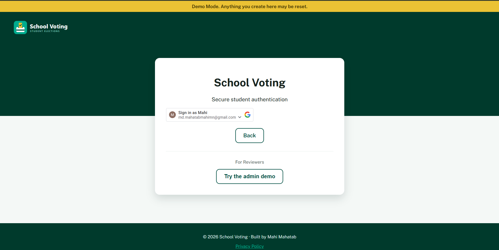
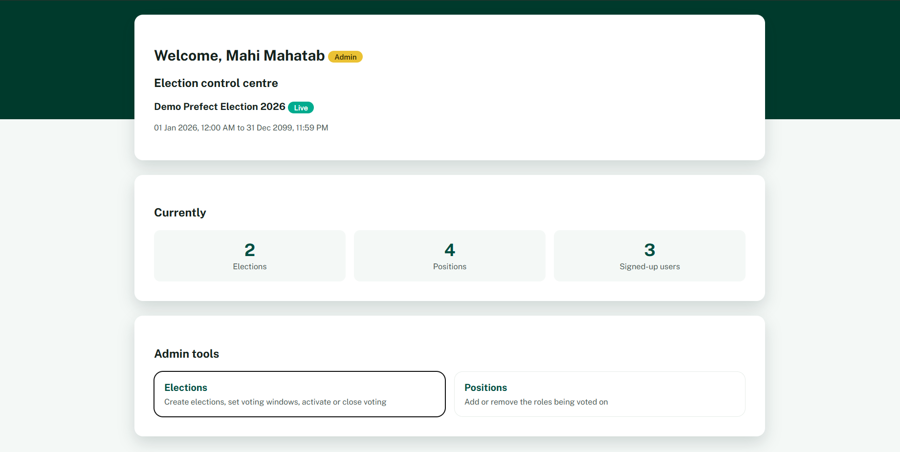
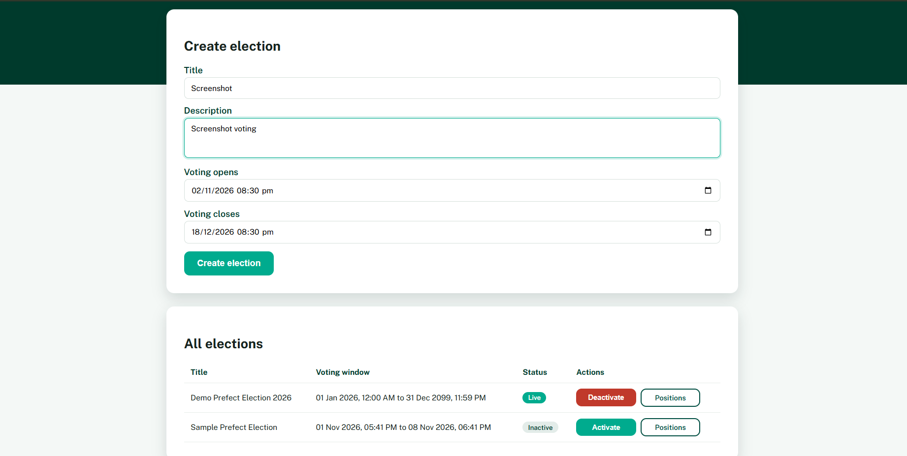
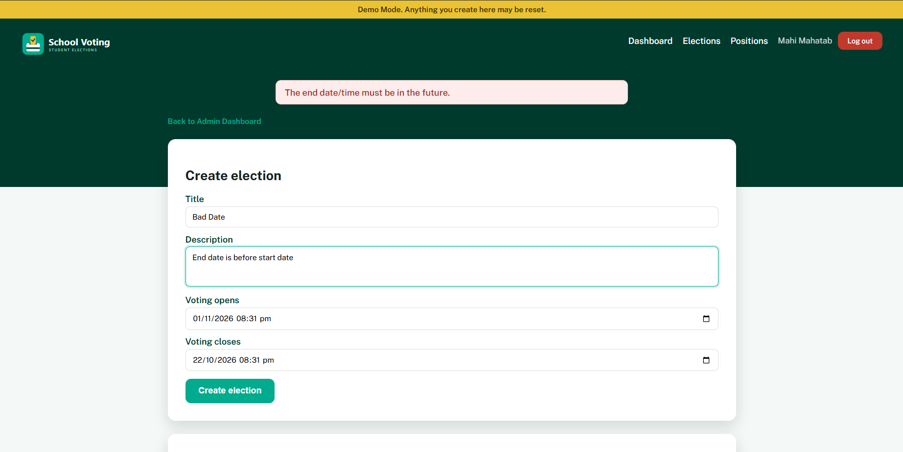
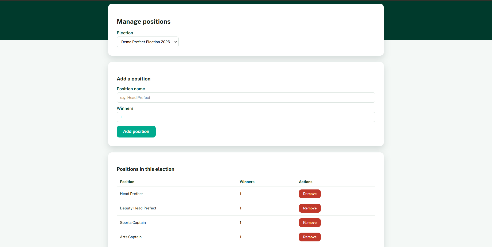
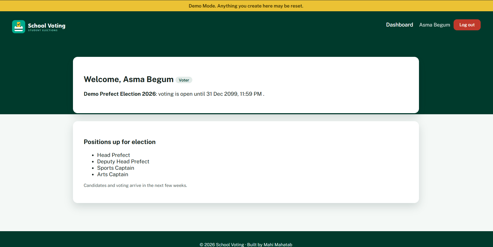
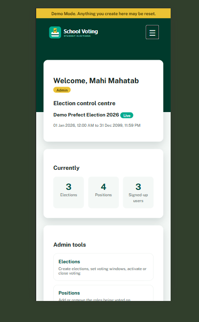
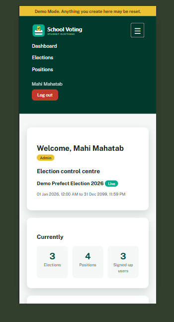

# School Voting

A web app for running school prefect elections. Students sign in with their school Google account, admins set up elections and positions, and voters see what's up for election. Built with with Flask and SQLite.

**Live demo:** https://schoolvoting.pythonanywhere.com/

---

## For Reviewers)

There's a ready-made election on the demo site, so there's nothing to set up.

1. Open the **[live demo](https://schoolvoting.pythonanywhere.com/)** and click **Login with Google**.
2. Sign in with **any Google account**, or skip Google completely by clicking **Try the admin demo** on the login page.
3. As a **normal user** you land on the voter dashboard. You'll see **Demo Prefect Election 2026**, whether voting is open, and the positions being voted on.
4. As the **demo admin** you land on the admin dashboard. Open **Elections** to see the demo election marked **Live**, then **Positions** to see (and add or remove) its positions. Try creating a second election and activating it. Only one election can be live at a time, so the first one switches off.
5. While signed in as the demo admin, visit `/voter` to see what a student sees.

The demo site is reset from time to time, so anything you create may disappear. Please don't enter anything private.

---

## Screenshots

**Login:** Google sign-in, plus the demo admin button on the demo site


**Admin dashboard:** live election, stats and tools


**Elections:** create elections, set a voting window, activate or deactivate


**Date Check:** bad dates are caught before anything is saved


**Positions:** the roles being voted on (Head Prefect, etc.)


**Voter dashboard:** what a student sees


**Phone layout:** responsive layout with a menu toggle




---

## Features

**Finished**
- Google sign-in, with the sign-in token verified on the server
- Role-based access control (admin and voter), with roles checked on every request
- Create elections with a voting window (New Zealand time) and only one election live at a time
- Add and remove positions for each election
- Voters see the live election and whether voting is open, not started yet, or closed
- CSRF protection, secure session cookies and security headers
- 403, 404, 405 and 500 pages, a `/health` check and a privacy policy
- Demo Mode for reviewers 

**Week 3 Goals**
- Candidates and their profiles (bio, photo, voice intro, video link)
- Casting votes and live results
- Admin tools: voters list, announcements, audit log

---
---

## Run it locally

You need Python 3.10+ and a Google Cloud OAuth client (Web application) with these authorised JavaScript origins: `http://localhost` and `http://localhost:5000`.

```bash
git clone https://github.com/Astral-Viscount/School-Voting.git
cd School-Voting

python -m venv venv
source venv/bin/activate          # Windows: .\venv\Scripts\Activate.ps1
pip install -r requirements.txt

python utils/secret_token.py      # copy the output into .env as SECRET_KEY
python utils/create_db.py         # create the database

python app.py                     # open http://localhost:5000
```

### Settings (`.env`)

| Variable | What it does |
|---|---|
| `SECRET_KEY` | Signs sessions. Required. Keep it private. |
| `GOOGLE_CLIENT_ID` | Your Google OAuth Client ID |
| `ADMIN_EMAILS` | Comma-separated emails that become admins when they sign in |
| `SCHOOL_DOMAIN` | Comma-separated email endings allowed to sign in, e.g. `@school.nz` |
| `COOKIE_SECURE` | Set to `1` in production (HTTPS only) |
| `DEMO_MODE` | Set to `1`  on the public demo site. It lets any Google account sign in and adds the demo-admin button.  |

### Tests

```bash
python -m pytest -q
```

### Deploying the demo (PythonAnywhere)

```bash
git pull
pip install -r requirements.txt
python utils/create_db.py
```

Then add `DEMO_MODE=1` and `COOKIE_SECURE=1` to the server's `.env`, add the site's URL as an authorised origin in Google Cloud, and reload the web app.

---
